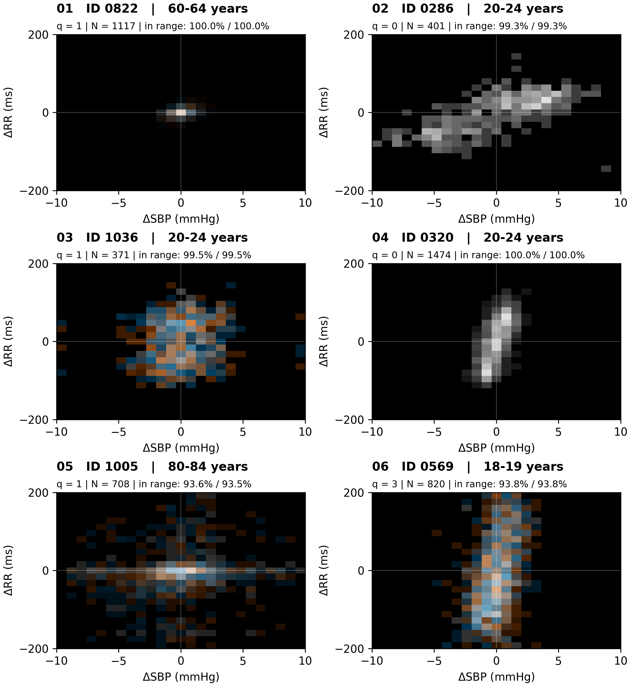

<div align="center">

# Baroreflex Representation Pipeline

### From cardiovascular signals to visual patterns.

Explore blood-pressure and heart-period dynamics through **Delta Coupling Maps**, clinical indicators, and machine-learning experiments.

**Python 3.10+ · PyTorch · Apple Silicon / CUDA / CPU · MIT licensed**

[Explore the maps](#a-different-view-of-cardiovascular-coupling) · [Get started](#get-started) · [Run an experiment](#run-your-own-experiment) · [Reproduce the study](#reproducing-the-paper-results) · [Repository](#inside-the-repository)

</div>

<p align="center">
  <a href="assets/readme/dcm_reading_guide.pdf">Delta Coupling Map reading guide (PDF)</a>
</p>

<p align="center">
  <em>Two signals. A shared coordinate system. Patterns you can inspect.</em>
</p>

## A different view of cardiovascular coupling

Blood pressure and the time between heartbeats fluctuate together. A single number can summarize an aspect of that relationship; a map lets you inspect the distribution behind it.

**Delta Coupling Maps (DCMs)** place beat-to-beat changes in systolic blood pressure and RR intervals on two axes. Two channels represent contemporaneous and lag-aligned increments, making their concentration, spread, sign asymmetry, and overlap visible in one display.

This repository connects that visual representation to a practical research workflow: process ECG and blood-pressure recordings, build complementary representations, and compare them in configurable prediction experiments.

- **Inspect the pattern.** See where paired increments concentrate and how their distributions differ.
- **Compare representations.** Evaluate maps alongside clinically interpretable indicators and automated time-series descriptors.
- **Keep experiments traceable.** Record configurations, input fingerprints, training histories, selected checkpoints, and participant-level predictions.

The maps describe observed coupling. They are not direct measurements of reflex gain, physiological latency, or autonomic activity.

## Same signals, three perspectives

| Representation | What it provides | Modeling route |
| --- | --- | --- |
| **Delta Coupling Maps** | A two-channel image of joint pressure/RR increments | Convolutional network |
| **Clinical indicators** | A compact panel of physiological and sequence-based descriptors | Multilayer perceptron |
| **Time-series descriptors** | A broad collection of automated tsfresh features | Multilayer perceptron |

The accompanying study uses 21 clinical indicators, 3,880 time-series descriptors, and two-channel 25 × 25 maps. The library reads model input dimensions from prepared tensors rather than fixing every experiment to those sizes.

<details>
<summary><strong>Explore more observed maps</strong> — different distributions on the same axes</summary>

<p align="center">
  <a href="assets/readme/dcm_diversity_1.png"></a>
</p>

These examples illustrate visual diversity, not diagnostic categories or a rule for inferring age from map shape. Each map is normalized per participant; brightness should not be read as an absolute between-person event count.

</details>

## Get started

Install the environment and explore the CLI:

```bash
uv sync --locked
uv run baroreflex-pipeline --help
uv run baroreflex-pipeline models
```

Prefer pip? Use `pip install -e .`. The CLI is also available as `python -m baroreflex_pipeline`.

Training supports **Apple Silicon (`mps`)**, **NVIDIA GPUs (`cuda`)**, and **CPU**. Use `auto` to select CUDA, then MPS, then CPU according to availability.

## Run your own experiment

Copy and edit the example configurations in `configs/`, then give your experiment its own output directory:

```bash
uv run baroreflex-pipeline --config configs/default.json workflow \
  --raw-dir data/raw \
  --output-dir outputs/experiments/my-study \
  --experiment-config configs/experiment.json \
  --models clinical scalar dcm \
  --epochs 100 --patience 15 --training-device auto
```

This runs downloading, signal processing, representation extraction, participant splitting, training-only preprocessing, and model fitting. Add `--skip-download` when the raw files are already available. Full-dataset processing and tsfresh extraction can take substantial time.

Already have prepared tensors? Train another model selection without processing the signals again:

```bash
uv run baroreflex-pipeline train \
  --experiment-config configs/experiment.json \
  --training-dir outputs/experiments/my-study/training_data \
  --run-dir outputs/experiments/my-study/runs/comparison \
  --models dcm dcm_only covariates_only \
  --seeds 42 43 --epochs 100 --patience 15 --device mps
```

Choose `cpu`, `cuda`, or `auto` instead of `mps` as appropriate. Nine model variants support comparisons with and without physiology, covariates, or individual DCM channels.

```bash
uv run baroreflex-pipeline status \
  --run-dir outputs/experiments/my-study/runs/comparison
```

Repeating an unchanged training command reuses completed seeds. Interrupted seeds restart; completed seeds remain available. Changes to data, source, environment, or settings require a new run directory. Concurrent writers to the same run are blocked.

Each run saves model summaries, participant-level predictions, per-seed training histories, and selected checkpoints in its output directory.

## Inside the repository

```text
src/baroreflex_pipeline/   Reusable library and public CLI
configs/                  Explicit processing and experiment examples
tests/                    Automated processing, training, and checkpoint tests
assets/readme/            Repository illustrations
paper/                    Local manuscript source and figures (ignored by Git)
data/                     Local dataset storage
outputs/                  Local prepared inputs, runs, analyses, and weights
```

[Processing configuration](configs/default.json) · [Experiment configuration](configs/experiment.json)

Configurations are explicit files, not packaged defaults. Copy the examples and pass them with `--config` or `--experiment-config`. Model input dimensions come from the prepared tensors.

Downloaded data and generated outputs are not distributed with the source code. In this working copy, the existing study results remain under `outputs/paper/`, with earlier local results under `outputs/history/`. Study configurations and cohort assignments are preserved under `outputs/paper/configs/` and `outputs/paper/cohort/`. Paper-specific generation scripts are not part of the maintained library.

Historical source evidence is retained in `outputs/paper/provenance/sources.zip`, with an entry checksum index and a documented launch-wrapper source-hash discrepancy in `exceptions.json`. Archived sources are never imported by the public CLI; original run provenance and weights remain unchanged.

<details>
<summary><strong>Tests and checkpoint inference</strong></summary>

Run the automated tests:

```bash
uv run python -m unittest discover -s tests -q
```

Apply one of your trained checkpoints to compatible prepared inputs:

```bash
uv run baroreflex-pipeline predict \
  --checkpoint outputs/experiments/my-study/runs/comparison/dcm/seed_42/best.pt \
  --inputs outputs/experiments/my-study/training_data/dcm.npz \
  --output outputs/experiments/my-study/predictions.csv --device auto
```

Prediction inputs must use the checkpoint's training preprocessing and feature order. Current self-describing checkpoints and original study checkpoints with their adjacent `run.json` are supported; loading never rewrites the original weights.

</details>

## Reproducing the paper results

**A Git checkout alone is not the complete reproduction package.** Git contains the maintained code and README illustrations; the local manuscript, `outputs/`, and raw recordings are excluded. Exact study inputs, fixed partitions, and original results must be obtained separately from the authors. No public artifact-download URL or deposition DOI is currently assigned. The following commands assume those artifacts have been supplied; there is no automatic paper-generation command.

### 1. Obtain the study artifacts

Keep their directory structure when placing them in the checkout:

```text
outputs/paper/
  configs/processing.json           Recorded signal-processing configuration
  configs/experiment.json           Recorded split, target, and fitting settings
  cohort/splits.csv                 Fixed participant assignments and targets
  prepared/training_data/           clinical.npz, scalar.npz, dcm.npz, metadata.json
  runs/reference/                  Original reference checkpoints and predictions
  runs/ablations/                  Original input-control checkpoints and predictions
  analysis/                        Exported comparisons and summary tables
  provenance/                      Archived source evidence and documented exception
```

Refitting from prepared inputs requires the configuration files and `prepared/training_data/`. The original runs and analyses are needed to inspect or verify the reported results. Raw-signal regeneration additionally requires the cohort assignments and Autonomic Aging recordings.

The paper protocol is **1,013 participants**, split into **709 training / 152 validation / 152 test**, with age-group midpoint targets and four covariates: sex, BMI, recording length, and device. Preserve participant identities, row order, targets, feature order, and training-only preprocessing—not just the partition sizes.

### 2. Refit all nine models with the public CLI

After `uv sync --locked`, run:

```bash
uv run baroreflex-pipeline train \
  --experiment-config outputs/paper/configs/experiment.json \
  --training-dir outputs/paper/prepared/training_data \
  --run-dir outputs/experiments/paper-replication/runs \
  --models clinical scalar dcm \
    covariates_only clinical_only scalar_only dcm_only \
    dcm_contemporaneous_covariates dcm_aligned_covariates \
  --epochs 5000 --patience 5000 --batch-size 64 \
  --learning-rate 0.001 --weight-decay 0.0001 \
  --device mps
```

The recorded configuration selects **20 seeds, 2025–2044**: three reference models and six input controls produce **180 seed runs** in total. Training uses AdamW with MSE loss; each seed's checkpoint is selected by its lowest validation MAE, not by test performance. Predictions from the 20 selected checkpoints are averaged for each model. Report ensemble MAE, not the mean of the 20 per-seed MAEs.

Do not use the short 100-epoch example as a paper reproduction. Use the supplied study configuration unchanged, without overriding its seeds. The 5,000-epoch patience intentionally allows the full fitting schedule; it does not mean that the final epoch is selected.

The recorded runs used **MPS and Python 3.14.2**; their provenance records the original package versions. `uv.lock` pins the maintained environment, not necessarily that historical environment. Use `cpu`, `cuda`, or `auto` if needed, but device, library-version, and maintained-source differences can change fitted weights and metrics. A fresh fit is not a claim of bitwise reproduction of the original run. The documented historical launch-wrapper source gap also prevents claiming complete source identity for that wrapper.

This is a substantial training job. Monitor it with:

```bash
uv run baroreflex-pipeline status \
  --run-dir outputs/experiments/paper-replication/runs
```

Reuse that new directory only for unchanged settings. Never point a refit at `outputs/paper/runs/`; those are the preserved original results.

### 3. Compare the exported results

The new run writes `<model>/summary.json` with `ensemble_metrics.test`, `<model>/predictions.csv` with ensemble predictions, and per-seed checkpoints, predictions, and histories. Compare these with the original run exports and `outputs/paper/analysis/results.csv`.

The reported reference **test ensemble** values are:

| Model | MAE (years) | RMSE (years) |
| --- | ---: | ---: |
| DCM + covariates | 7.96 | 11.71 |
| Clinical indicators + covariates | 7.87 | 11.33 |
| Time-series descriptors + covariates | 8.30 | 12.13 |

For numerical verification without retraining, use the supplied original ensemble CSVs: filter `split == "test"`, compute `mean(abs(prediction - target))` and `sqrt(mean((prediction - target) ** 2))`, and check participant alignment before paired comparisons. This verifies exported metrics; it does not independently repeat preprocessing or fitting. The maintained CLI does not regenerate every retrospective paper analysis or figure automatically.

<details>
<summary><strong>Optional: regenerate inputs from raw recordings</strong></summary>

With the study artifacts available, download and process the raw dataset into a separate directory, then reuse the supplied fixed assignments:

```bash
uv run baroreflex-pipeline --config outputs/paper/configs/processing.json download \
  --raw-dir data/raw
uv run baroreflex-pipeline --config outputs/paper/configs/processing.json process \
  --raw-dir data/raw \
  --output-dir outputs/experiments/paper-regenerated \
  --scalar-feature-set efficient --no-figures
cp outputs/paper/cohort/splits.csv outputs/experiments/paper-regenerated/splits.csv
uv run baroreflex-pipeline prepare-training \
  --output-dir outputs/experiments/paper-regenerated
```

Do not call `split` or the all-in-one `workflow` for an exact-cohort attempt: those create partitions rather than reusing the supplied assignments. A matching random seed alone is not a substitute for the recorded participant list and ordering.

Check that all cohort records processed successfully. Expected input shapes are `(1013, 21)` for clinical indicators, `(1013, 3880)` for time-series descriptors, and `(1013, 2, 25, 25)` for DCM. Medians and scaling statistics must be fitted only on the 709 training participants. Verify the raw-data checksums against the supplied cohort manifest and compare array values, feature names, shared covariates, targets, and assignments with the supplied prepared artifacts before describing the regenerated inputs as equivalent. Matching shapes alone is insufficient.

To fit these regenerated tensors, use the training command above with `--training-dir outputs/experiments/paper-regenerated/training_data` and a different, unused `--run-dir`.

</details>

## Research scope

The accompanying benchmark predicts anonymized **age-group midpoints**, not biological age or a clinical outcome. It is exploratory research on a single healthy resting cohort, not a diagnostic or deployment-ready system. Similar prediction errors do not establish information equivalence between representations.

Clinical sequence-to-ramp descriptors are implementation-specific and should not be treated as validated conventional baroreflex effectiveness indices. DCM alignment is operational, not an identified physiological delay. The manuscript describes the methods, results, and limitations; its source is maintained locally under `paper/` and is not distributed through Git.

## Data, citation, and license

The pipeline targets **Autonomic Aging v1.0.0**, available from [PhysioNet](https://doi.org/10.13026/2hsy-t491). Raw-data use is governed by the dataset's own license, separately from this software. Downloaded recordings belong in `data/raw/` and remain excluded from Git.

Developed by Jose J. H. Galvez, Jose J. Hernandez-Cabrera, Jose Evora-Gomez, and Juan A. Montiel-Nelson at the **University of Las Palmas de Gran Canaria**.

If you use this work, cite the software using [CITATION.cff](CITATION.cff) and credit the source dataset. Software is released under the [MIT license](LICENSE). No public deposition DOI has been assigned to this repository.
